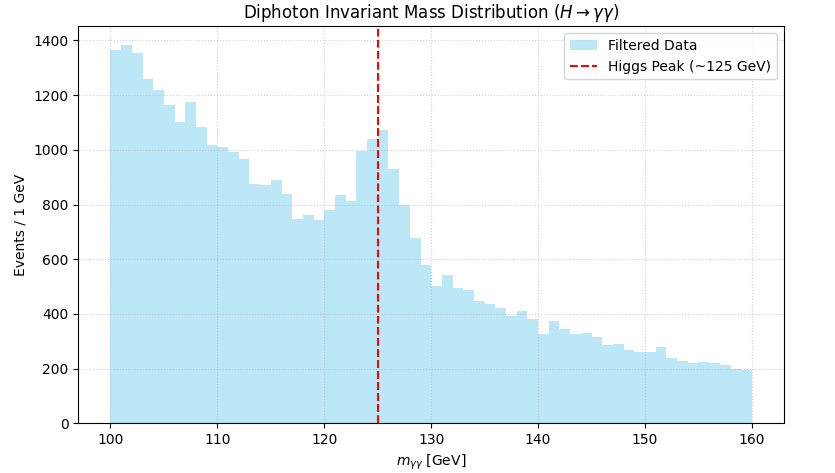
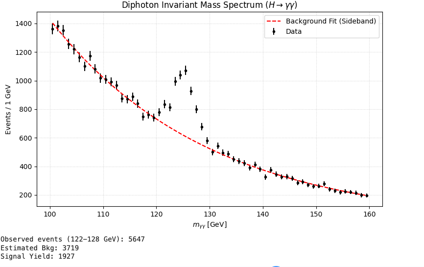

# Higgs Boson (H -> γγ) Diphoton Analysis

A simple Python analysis of the Higgs-to-diphoton decay channel. This project simulates diphoton collision events in ROOT format, applies photon momentum cuts, and uses sideband fitting to isolate the 125 GeV Higgs signal peak.

# What this notebook does

1. Generates synthetic diphoton events (exponential background + 125 GeV Gaussian signal) and saves/reads them using uproot.
2. Applies baseline photon transverse momentum cuts (pT1 > 35 GeV and pT2 > 25 GeV) to filter out low-energy background.
3. Fits an exponential background curve to the sideband regions (below 120 GeV and above 130 GeV) so the signal peak doesn't skew the fit.
4. Estimates the final signal yield inside the 122–128 GeV mass window.

#Plots and Results

# Filtered Invariant Mass Distribution

# Sideband Background Fit

Results inside the 122–128 GeV window:
- Observed events: 5647
- Estimated background: 3719
- Extracted signal yield: 1927 events

#Tools Used
uproot, numpy, pandas, scipy, matplotlib
